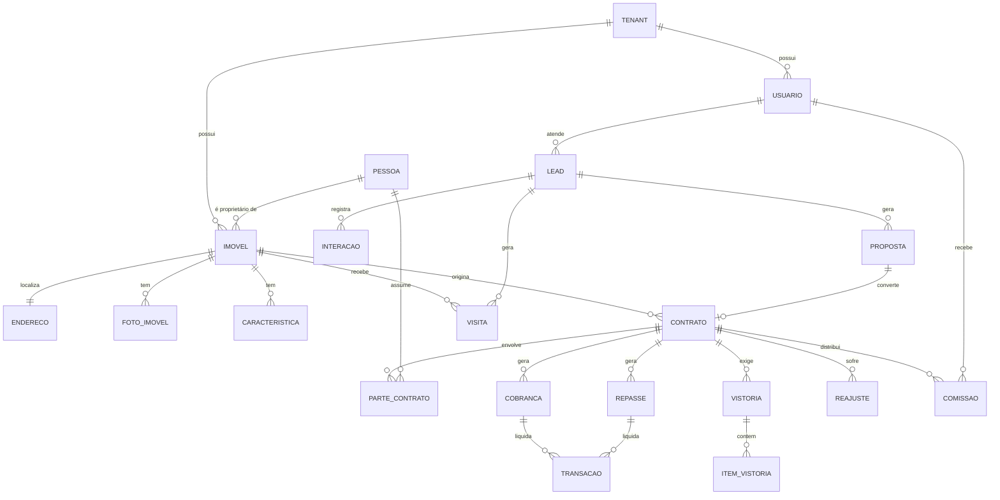
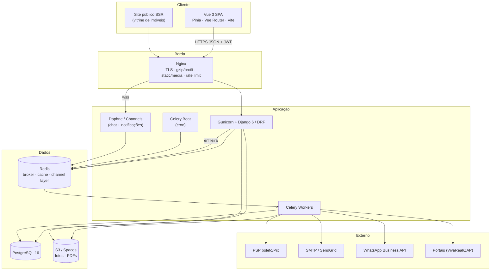

# Handoff Técnico ImobiPro

**Sistema de Gestão Imobiliária Django REST + Vue.js**
Versão 1.0 · Documento de arquitetura pré-código · 18/08/2026

---

## 0. Fase 1 Ingestão de conhecimento (repositórios UFLA)

A organização `ufla-prog-web` foi acessada via API do GitHub. Repositórios com `aula` no nome, efetivamente encontrados:

| Repositório | Foco | Extraído para o projeto |
|---|---|---|
| `aula-arquitetura-web` | Evolução da web, HTTP, cliente/servidor | Separação estrita cliente/servidor; API stateless |
| `aula-html-css-js` | Camada de apresentação | Semântica, progressive enhancement |
| `aula-bootstrap` | Framework de UI | Grid responsivo, design system utilitário |
| `aula-django-01` | Visão geral do Django | Projeto vs app, `settings`, `urls`, migrations |
| `aula-django-02/03/04` | Sistema de biblioteca em Django | Estrutura `projeto/` + `app/`, `models.py` → `views.py` → `urls.py` → templates, `admin.py` registrado, migrations versionadas |
| `aula-djangorest-01` | Django REST Framework | Serializer → ViewSet → Router, Browsable API, teste via Postman |
| `aula-mkdocs` | Documentação | Documentação versionada junto ao código |
| `projeto-gestao-tccs` | **API REST completa de referência** | Padrão canônico da disciplina (abaixo) |

### 0.1 Padrão canônico observado em `projeto-gestao-tccs`

Código real do repositório, que define a "linguagem" técnica que este projeto deve falar:

```
projeto/
├── core/                 # app único de domínio
│   ├── models.py         # entidades + *_CHOICES como constantes de classe
│   ├── serializers.py    # ModelSerializer; *_display via get_FOO_display
│   ├── views.py          # ModelViewSet + filter_backends + @action custom
│   ├── urls.py           # DefaultRouter().register(...)
│   └── migrations/
├── tcc_project/settings.py
├── manage.py
└── requirements.txt      # Django 6.0, DRF 3.16, django-filter, django-cors-headers
```

Práticas que **herdamos**:

1. **Router + ViewSet** como padrão de roteamento (nunca URLs manuais para CRUD).
2. `ModelSerializer` com campos `*_display` derivados de `get_<campo>_display()` o front nunca traduz códigos de status.
3. Endpoints analíticos como `@action(detail=False)` ex.: `/api/tccs/estatisticas/` com agregações `values().annotate(Count())`. **É exatamente o padrão do nosso dashboard.**
4. `filter_backends` + `search_fields` declarativos.
5. `LANGUAGE_CODE = 'pt-BR'`, `TIME_ZONE = 'America/Sao_Paulo'`.
6. `MEDIA_URL` servido via `static()` só em `DEBUG` produção usa servidor dedicado.
7. `requirements.txt` com versões fixadas.

Práticas que **corrigimos deliberadamente** (o repositório é didático, não é produção):

| Repositório de aula | ImobiPro (produção) | Motivo |
|---|---|---|
| `CORS_ALLOW_ALL_ORIGINS = True` | `CORS_ALLOWED_ORIGINS` explícito por ambiente | Superfície de ataque |
| SQLite | PostgreSQL 16 | Transações financeiras, concorrência, `JSONB`, índices GIN |
| Sem autenticação nas ViewSets | JWT + `IsAuthenticated` + permissões por papel | Multi-usuário comercial |
| `SECRET_KEY`/`DEBUG` no arquivo | `django-environ` + `.env` fora do versionamento | Segredo não vai para o Git |
| `fields = '__all__'` | Campos explícitos por serializer | Evita vazar `custo_aquisicao`, `comissao` |
| App único `core` | Apps por bounded context | Escala e propriedade de código |
| `tests.py` vazio | pytest + cobertura mínima 80% | Gate de qualidade |

---

## 1. Visão do produto e regras de negócio
*(Corretor/Especialista Imobiliário Sênior)*

### 1.1 Posicionamento

SaaS **multi-tenant** para imobiliárias de pequeno e médio porte (2 a 50 corretores). Cada imobiliária é um *tenant* isolado logicamente. Venda por assinatura mensal, por faixa de corretores ativos.

Diferencial comercial: **um único sistema cobre o ciclo inteiro** captação → publicação → lead → visita → proposta → contrato → repasse/comissão → renovação. O concorrente típico cobre CRM *ou* administração de locação, raramente os dois bem.

### 1.2 Papéis (RBAC)

| Papel | Escopo |
|---|---|
| `SUPERADMIN` | Operador da plataforma; gerencia tenants e planos |
| `ADMIN` | Dono/gestor da imobiliária; vê tudo do tenant, inclusive financeiro |
| `GERENTE` | Gerencia equipe, redistribui leads, vê funil consolidado |
| `CORRETOR` | Vê seus leads, seus imóveis captados e a carteira pública |
| `FINANCEIRO` | Contas a pagar/receber, repasses, boletos; sem acesso a CRM |
| `PROPRIETARIO` | Portal externo: extrato de repasses, contratos, vistorias do seu imóvel |
| `INQUILINO` | Portal externo: 2ª via de boleto, chamados de manutenção, contrato |

### 1.3 Módulo Imóveis (captação)

- Cadastro com **código interno único por tenant** (`REF-000123`), gerado por sequência.
- Tipos: apartamento, casa, casa de condomínio, terreno, sala comercial, galpão, rural, cobertura, kitnet.
- Finalidade: `VENDA`, `LOCACAO`, `VENDA_E_LOCACAO`, `TEMPORADA`.
- **Regra:** imóvel só entra em `DISPONIVEL` com mínimo de 5 fotos, endereço geocodificado, proprietário vinculado, valor definido e, para locação, matrícula informada. Validação no `serializer`, não só no front.
- Situação: `EM_CAPTACAO` → `DISPONIVEL` → `RESERVADO` → `VENDIDO` | `LOCADO` → `INATIVO`. Transições ilegais são rejeitadas por máquina de estados no model.
- **Exclusividade:** contrato de captação com data de início/fim. Vencendo em ≤15 dias, dispara alerta ao captador.
- Autorização de venda (documento assinado) obrigatória para publicar em portais.
- Custos vinculados: IPTU (valor anual + nº de parcelas), condomínio mensal, matrícula, inscrição municipal.
- Mídia: fotos com ordenação (drag-and-drop), foto de capa, marca d'água automática do tenant, tour 360°, vídeo (YouTube/Vimeo), planta baixa em PDF.
- Geolocalização: `latitude`/`longitude` para o mapa; busca por raio.

### 1.4 Módulo CRM / Funil de vendas

- Lead entra por: site próprio, portal integrado (webhook), telefone, WhatsApp, indicação, plantão, placa.
- **Distribuição automática** por *round-robin* entre corretores ativos, com respeito a especialidade (bairro/tipo) e a escala de plantão.
- **SLA de primeiro atendimento: 15 min.** Estourou, o lead volta para a fila e o gerente é notificado. Métrica vendida como diferencial.
- Funil (kanban, arrastável): `NOVO` → `EM_CONTATO` → `QUALIFICADO` → `VISITA_AGENDADA` → `VISITA_REALIZADA` → `PROPOSTA` → `NEGOCIACAO` → `FECHADO_GANHO` | `FECHADO_PERDIDO`.
- Perda exige **motivo obrigatório** (preço, localização, crédito negado, comprou com concorrente, desistiu) alimenta o relatório de perdas.
- Timeline por lead: ligações, WhatsApp, e-mails, visitas, propostas, anotações. Nada é apagado (auditoria).
- Agendamento de visita com confirmação por e-mail/WhatsApp e feedback pós-visita obrigatório.
- Proposta: valor ofertado, condições de pagamento, validade; fluxo `ENVIADA` → `EM_ANALISE` → `ACEITA` | `RECUSADA` | `CONTRAPROPOSTA`.

### 1.5 Módulo Locação (o que dá recorrência ao SaaS)

- Contrato: locador (pode ser mais de um), locatário, fiador/seguro-fiança/caução/título de capitalização, prazo (30 meses padrão), índice de reajuste (IGP-M/IPCA), dia de vencimento, multa e juros por atraso, taxa de administração (%), taxa de intermediação (primeiro aluguel).
- **Geração automática mensal de cobranças** (job Celery, dia D-10): aluguel + condomínio + IPTU parcelado + seguro incêndio + água/gás rateados.
- **Repasse ao proprietário**: `aluguel recebido − taxa de administração − retenções (IR, manutenções pagas pela imobiliária)`. Regra de repasse: `D+1` do recebimento ou data fixa configurável.
- **Reajuste anual automático**: no 12º mês, aplica o índice acumulado, gera aditivo em PDF, notifica ambas as partes 30 dias antes.
- **Renovação/rescisão**: alerta 90 dias antes do fim. Rescisão antecipada calcula multa proporcional (`multa × meses_restantes / prazo_total`).
- **Inadimplência**: régua de cobrança automática D+1 lembrete, D+5 cobrança, D+15 aviso formal, D+30 encaminhamento jurídico. Cada passo é um job com log.
- **Vistorias**: entrada, periódica, saída. Checklist por cômodo, com fotos, estado (`OTIMO`/`BOM`/`REGULAR`/`RUIM`) e observação. Laudo em PDF assinado digitalmente. O comparativo entrada × saída é o que resolve disputa de caução.

### 1.6 Módulo Financeiro

- Plano de contas simples (receitas/despesas por categoria).
- Contas a receber (do inquilino/comprador) e a pagar (ao proprietário/fornecedor).
- Conciliação bancária por importação de arquivo de retorno **CNAB 240/400** e/ou API de PSP (Pix/boleto).
- Comissão de venda: percentual do VGV, com **rateio configurável** ex.: 6% total → 40% captador, 40% vendedor, 20% imobiliária. Só liquida com contrato assinado + entrada recebida.
- DRE simplificado mensal e relatório de comissões por corretor.

### 1.7 Regras de negócio críticas (invariantes do sistema)

1. Nenhum contrato ativo sem imóvel `DISPONIVEL` ou `RESERVADO` no instante da assinatura.
2. Um imóvel não pode ter dois contratos de locação vigentes com períodos sobrepostos restrição de exclusão no PostgreSQL (`EXCLUDE USING gist`).
3. Transação financeira **nunca é deletada**; é estornada com lançamento de contrapartida.
4. Valor de comissão é congelado (snapshot) no fechamento mudar a tabela de comissões não reescreve o passado.
5. Todo dado é filtrado por `tenant` em nível de *queryset base*, não por filtro manual em cada view.
6. Alteração de valor de imóvel, status de contrato e valor de repasse gera registro de auditoria com autor, IP, antes/depois.

---

## 2. Modelagem de dados
*(DBA Sênior PostgreSQL 16)*

### 2.1 Diagrama de entidades



### 2.2 Entidades principais

**`Tenant`** `id (UUID)`, `razao_social`, `cnpj (unique)`, `creci`, `subdominio (unique)`, `plano`, `ativo`, `logo`, `cor_primaria`, `criado_em`.

**`Usuario`** (estende `AbstractUser`) `tenant (FK)`, `email (unique, USERNAME_FIELD)`, `nome_completo`, `telefone`, `creci`, `papel (choices)`, `avatar`, `ativo`, `ultimo_acesso`. Índice: `(tenant, papel, ativo)`.

**`Pessoa`** contraparte não-usuária. `tenant`, `tipo (FISICA|JURIDICA)`, `nome`, `cpf_cnpj`, `rg_ie`, `data_nascimento`, `estado_civil`, `profissao`, `renda_mensal`, `email`, `telefone`, `whatsapp`, `endereco (FK)`, `dados_bancarios (JSONB)`, `observacoes`. Único: `(tenant, cpf_cnpj)`.

**`Endereco`** `cep`, `logradouro`, `numero`, `complemento`, `bairro`, `cidade`, `uf`, `latitude (Decimal 9,6)`, `longitude (Decimal 9,6)`. Índice composto `(cidade, bairro)`.

**`Imovel`** `tenant`, `codigo (unique por tenant)`, `titulo`, `descricao`, `tipo`, `finalidade`, `situacao`, `proprietario (FK Pessoa)`, `captador (FK Usuario)`, `endereco (FK, 1:1)`, `area_total`, `area_util`, `quartos`, `suites`, `banheiros`, `vagas`, `andar`, `ano_construcao`, `mobiliado (bool)`, `aceita_pet (bool)`, `valor_venda`, `valor_locacao`, `valor_condominio`, `valor_iptu_anual`, `matricula`, `inscricao_municipal`, `exclusividade_ate`, `publicado_site (bool)`, `destaque (bool)`, `visualizacoes (int)`, `criado_em`, `atualizado_em`.
Índices: B-tree em `(tenant, situacao, finalidade)`; GIN em `to_tsvector('portuguese', titulo || descricao)` para busca textual; índice em `(latitude, longitude)` para o mapa.

**`Caracteristica`** / **`ImovelCaracteristica`** M2M (piscina, churrasqueira, elevador, portaria 24h, academia…). Tabela separada, não `JSONB`, para permitir filtro indexado.

**`FotoImovel`** `imovel`, `arquivo`, `arquivo_thumb`, `legenda`, `ordem (int)`, `capa (bool)`. Ordenação por `ordem`.

**`Lead`** `tenant`, `nome`, `email`, `telefone`, `origem`, `imovel_interesse (FK, null)`, `corretor (FK Usuario, null)`, `estagio (choices)`, `temperatura (FRIO|MORNO|QUENTE)`, `valor_estimado`, `motivo_perda`, `primeiro_contato_em`, `sla_cumprido (bool)`, `criado_em`. Índice: `(tenant, estagio, corretor)`.

**`Interacao`** `lead`, `usuario`, `tipo (LIGACAO|EMAIL|WHATSAPP|VISITA|NOTA)`, `descricao`, `criado_em`. Append-only.

**`Visita`** `lead`, `imovel`, `corretor`, `agendada_para`, `realizada (bool)`, `feedback`, `interesse_pos_visita`.

**`Proposta`** `lead`, `imovel`, `valor_ofertado`, `condicoes_pagamento`, `validade`, `status`, `arquivo_pdf`.

**`Contrato`** `tenant`, `numero (unique por tenant)`, `tipo (VENDA|LOCACAO)`, `imovel`, `proposta (FK, null)`, `data_inicio`, `data_fim`, `valor`, `dia_vencimento`, `indice_reajuste`, `taxa_administracao_percent`, `taxa_intermediacao`, `garantia_tipo`, `garantia_valor`, `multa_rescisoria_meses`, `status (RASCUNHO|ATIVO|ENCERRADO|RESCINDIDO)`, `arquivo_pdf`, `assinado_em`.
Restrição: `EXCLUDE USING gist (imovel_id WITH =, daterange(data_inicio, data_fim) WITH &&) WHERE (tipo='LOCACAO' AND status='ATIVO')`.

**`ParteContrato`** `contrato`, `pessoa`, `papel (LOCADOR|LOCATARIO|FIADOR|COMPRADOR|VENDEDOR)`, `percentual`. Resolve múltiplos proprietários.

**`Cobranca`** `contrato`, `competencia (date)`, `vencimento`, `valor_aluguel`, `valor_condominio`, `valor_iptu`, `valor_seguro`, `outros`, `valor_total`, `valor_pago`, `pago_em`, `status (ABERTA|PAGA|ATRASADA|CANCELADA)`, `nosso_numero`, `linha_digitavel`, `pix_copia_cola`. Único: `(contrato, competencia)`.

**`Repasse`** `contrato`, `competencia`, `valor_bruto`, `taxa_administracao`, `retencoes (JSONB)`, `valor_liquido`, `status`, `pago_em`, `comprovante`.

**`Transacao`** `tenant`, `tipo (RECEITA|DESPESA)`, `categoria`, `descricao`, `valor`, `data_competencia`, `data_liquidacao`, `cobranca (FK, null)`, `repasse (FK, null)`, `estorno_de (self FK, null)`, `criado_por`. **Nunca deletada.**

**`Comissao`** `contrato`, `usuario`, `papel (CAPTADOR|VENDEDOR|IMOBILIARIA)`, `percentual_snapshot`, `valor`, `status (PREVISTA|LIBERADA|PAGA)`, `pago_em`.

**`Vistoria`** `contrato`, `tipo (ENTRADA|PERIODICA|SAIDA)`, `realizada_em`, `vistoriador`, `laudo_pdf`, `assinatura_locatario`, `assinatura_imobiliaria`.
**`ItemVistoria`** `vistoria`, `comodo`, `item`, `estado`, `observacao`, `fotos (M2M)`.

**`Reajuste`** `contrato`, `data_aplicacao`, `indice`, `percentual`, `valor_anterior`, `valor_novo`, `aditivo_pdf`.

**`LogAuditoria`** `tenant`, `usuario`, `modelo`, `objeto_id`, `acao (CREATE|UPDATE|DELETE)`, `alteracoes (JSONB before/after)`, `ip`, `user_agent`, `criado_em`. Particionada por mês.

### 2.3 Decisões de modelagem defendidas

- **Multi-tenancy por coluna `tenant_id` + manager padrão filtrado**, não schema-per-tenant. Simplifica migrations e backup; o isolamento é garantido por `TenantManager` e por testes que provam vazamento zero.
- **`Decimal(12,2)` para todo dinheiro.** `Float` em sistema financeiro é defeito, não escolha.
- **Soft delete (`deletado_em`) em Imóvel, Contrato e Pessoa**; hard delete só em rascunhos.
- **`JSONB` apenas para dado sem consulta relacional** (retenções, snapshot de auditoria). O resto é normalizado.
- **Timestamps com timezone** (`USE_TZ = True`), gravados em UTC, exibidos em `America/Sao_Paulo`.

---

## 3. Arquitetura do sistema
*(Arquiteto de Software Sênior)*

### 3.1 Diagrama lógico



### 3.2 Decisões de arquitetura

| Decisão | Escolha | Alternativa descartada | Motivo |
|---|---|---|---|
| Estilo de API | REST/DRF | GraphQL | O padrão da disciplina é DRF; REST tem cache HTTP trivial e o domínio é CRUD-pesado. GraphQL só se e quando o app mobile exigir |
| Autenticação | JWT (`simplejwt`), access 15 min + refresh 7 dias rotativo em cookie `HttpOnly` | Token DRF fixo | Expiração curta, revogação por blacklist, SPA sem sessão |
| Tempo real | Django Channels sobre Redis | Polling | Notificação de lead novo tem que ser instantânea é o SLA de 15 min |
| Assíncrono | Celery + Redis | `threading` | Geração de cobrança, PDFs, envio de e-mail e sync de portal não podem bloquear request |
| Estado no front | Pinia | Vuex | Padrão atual do Vue 3, tipagem melhor, sem boilerplate de mutations |
| UI | Tailwind CSS + componentes próprios | Vuetify | O diferencial é visual; Vuetify engessa a identidade. Aproveita a base de `aula-bootstrap` (grid/responsivo) |
| Arquivos | S3-compatível via `django-storages` | Disco local | Stateless na aplicação, escala horizontal |
| Migrations | Django nativo | Ferramenta externa | Já é o padrão das aulas e é confiável |

### 3.3 Fluxo de autenticação

```
POST /api/auth/login/  {email, senha}
  → 200 {access, user, tenant}  + Set-Cookie: refresh=<jwt>; HttpOnly; Secure; SameSite=Strict
Interceptor Axios injeta  Authorization: Bearer <access>
401 → POST /api/auth/refresh/ (cookie) → novo access → refaz a requisição original
Logout → refresh vai para blacklist
```

Middleware `TenantMiddleware` resolve o tenant a partir do claim do JWT e o injeta em `request.tenant`. `TenantQuerySetMixin` aplica `.filter(tenant=request.tenant)` na base de toda ViewSet **isolamento não é responsabilidade do desenvolvedor de feature**.

### 3.4 Tarefas agendadas (Celery Beat)

| Tarefa | Frequência |
|---|---|
| `gerar_cobrancas_mensais` | Diária 02:00 (dia D-10 de cada contrato) |
| `regua_inadimplencia` | Diária 08:00 |
| `aplicar_reajustes_anuais` | Diária 03:00 |
| `alertar_contratos_a_vencer` (90/60/30 dias) | Diária 08:30 |
| `alertar_exclusividade_a_vencer` | Semanal, segunda 09:00 |
| `redistribuir_leads_sla_estourado` | A cada 5 min |
| `sincronizar_portais` | A cada 30 min |
| `conciliar_retorno_bancario` | Diária 20:00 |
| `backup_logico_postgres` | Diária 01:00 |

### 3.5 Segurança

- HTTPS obrigatório; HSTS; `SECURE_SSL_REDIRECT`.
- `CORS_ALLOWED_ORIGINS` explícito por ambiente (corrige o `CORS_ALLOW_ALL_ORIGINS` das aulas).
- Throttling DRF: 1000/h autenticado, 100/h anônimo, 5/min no login.
- Senhas com Argon2.
- Segredos via `django-environ`; `.env` fora do Git; em produção via secret manager.
- Uploads: validação de MIME real, limite de 10 MB, nome randomizado, servidos por URL assinada com expiração.
- Rate limit também no Nginx, como segunda camada.
- `LogAuditoria` em toda mutação de dado financeiro ou contratual.
- LGPD: consentimento registrado no lead, exportação e anonimização de dados pessoais sob requisição.

---

## 4. UX/UI lógica de telas
*(UX/UI Designer Sênior)*

### 4.1 Princípios

1. **O corretor trabalha em pé, no celular, entre visitas.** Mobile-first não é slogan: o kanban e a ficha do imóvel precisam funcionar com uma mão.
2. **Três cliques até a ação de dinheiro.** Login → lead → registrar interação.
3. **O dashboard responde "quanto vou ganhar esse mês", não "quantos registros existem".**
4. Estados vazios sempre com ação sugerida; nunca uma tabela vazia sem saída.

### 4.2 Mapa de telas

```
/login                        Login · recuperação de senha
/                             Dashboard
/imoveis                      Listagem (grid de cards ⇄ tabela ⇄ mapa)
/imoveis/novo                 Wizard de captação (5 passos)
/imoveis/:id                  Ficha do imóvel (abas)
/crm                          Kanban do funil
/crm/leads/:id                Ficha do lead + timeline
/agenda                       Calendário de visitas
/contratos                    Listagem de contratos
/contratos/:id                Ficha do contrato (abas)
/contratos/novo               Wizard de contrato
/financeiro/receber           Contas a receber · conciliação
/financeiro/pagar             Repasses e despesas
/financeiro/comissoes         Comissões por corretor
/vistorias/:id                Execução de vistoria (mobile-first)
/relatorios                   DRE · funil · desempenho
/configuracoes                Tenant, usuários, integrações, tabela de comissão
```

### 4.3 Dashboard (tela mais vendida na demo)

- **Faixa de KPIs:** VGV do mês, comissão prevista, aluguéis a receber, inadimplência (%), leads novos, taxa de conversão.
- **Funil visual** com valor por estágio, não só contagem.
- **"Precisa de você hoje":** leads sem contato dentro do SLA, visitas de hoje, contratos vencendo, cobranças atrasadas. É a primeira coisa que o corretor lê.
- **Gráficos:** vendas × locações (12 meses), origem dos leads, ranking de corretores.
- Fonte única: endpoint `@action` agregado mesmo padrão de `/api/tccs/estatisticas/` do repositório da disciplina.

### 4.4 Ficha do imóvel

Cabeçalho com galeria, código, badge de situação e ações (editar, publicar, compartilhar link público, gerar PDF).
Abas: **Dados** · **Fotos e mídia** (drag-and-drop) · **Proprietário** · **Documentos** · **Histórico** (linha do tempo de preços e status) · **Interessados** (leads ligados ao imóvel) · **Contratos**.

### 4.5 Kanban de vendas

Colunas por estágio, cartão com foto do imóvel, nome do lead, valor e ícone de temperatura. Drag-and-drop com atualização otimista (rollback se a API falhar). Cartão fica com borda vermelha pulsante quando o SLA está por estourar. Filtros: corretor, período, origem, faixa de valor.

### 4.6 Design system

Tailwind com tokens: cores por tenant (`cor_primaria` do banco vira CSS custom property), escala de espaçamento 4 px, `Inter` para texto e tabular numérico para valores.
Componentes base: `BaseButton`, `BaseInput`, `BaseSelect`, `BaseModal`, `BaseTable` (ordenação/paginação/seleção), `BaseCard`, `DataEmptyState`, `MoneyInput` (máscara BRL), `CpfCnpjInput`, `StatusBadge`, `FileUploader`.
Acessibilidade: contraste AA, foco visível, navegação por teclado no kanban, `aria-label` em ícone sem texto.

---

## 5. Especificação da API
*(Dev Backend Sênior)*

Base: `/api/v1/`. Autenticação `Bearer`. Paginação `?page=&page_size=` (padrão 20, máx 100). Erros no formato `{"detail": "...", "code": "...", "campos": {...}}`. Documentação OpenAPI em `/api/docs/` via `drf-spectacular`.

### 5.1 Autenticação

```http
POST   /api/v1/auth/login/            {email, password} → {access, user}
POST   /api/v1/auth/refresh/          (cookie refresh) → {access}
POST   /api/v1/auth/logout/           → 204
GET    /api/v1/auth/me/               → perfil + permissões
POST   /api/v1/auth/password-reset/   {email} → 202
```

### 5.2 Imóveis

```http
GET    /api/v1/imoveis/
       ?situacao=DISPONIVEL&finalidade=LOCACAO&tipo=APARTAMENTO
       &quartos_min=2&vagas_min=1&valor_min=1500&valor_max=3000
       &cidade=Lavras&bairro=Centro&caracteristicas=piscina,elevador
       &search=cobertura+mobiliada&ordering=-criado_em
       &lat=-21.24&lng=-44.99&raio_km=5
POST   /api/v1/imoveis/
GET    /api/v1/imoveis/{id}/
PATCH  /api/v1/imoveis/{id}/
DELETE /api/v1/imoveis/{id}/                  # soft delete
POST   /api/v1/imoveis/{id}/fotos/            # multipart, múltiplos arquivos
PATCH  /api/v1/imoveis/{id}/fotos/reordenar/  {ordem: [id, id, ...]}
DELETE /api/v1/imoveis/{id}/fotos/{foto_id}/
POST   /api/v1/imoveis/{id}/publicar/         # valida as regras de publicação
POST   /api/v1/imoveis/{id}/despublicar/
GET    /api/v1/imoveis/{id}/historico/
GET    /api/v1/imoveis/{id}/pdf/              # ficha em PDF
GET    /api/v1/imoveis/mapa/                  # GeoJSON enxuto para o mapa
GET    /api/v1/imoveis/estatisticas/          # agregações do dashboard
```

### 5.3 CRM

```http
GET    /api/v1/leads/?estagio=QUALIFICADO&corretor=me&temperatura=QUENTE
POST   /api/v1/leads/
PATCH  /api/v1/leads/{id}/
PATCH  /api/v1/leads/{id}/mover/          {estagio, motivo_perda?}
POST   /api/v1/leads/{id}/interacoes/     {tipo, descricao}
POST   /api/v1/leads/{id}/atribuir/       {corretor_id}
GET    /api/v1/leads/funil/               # kanban já agrupado por estágio
GET    /api/v1/leads/estatisticas/        # conversão, SLA, origem, perdas
POST   /api/v1/leads/webhook/{origem}/    # entrada de portal sem JWT, HMAC
GET    /api/v1/visitas/?data=2026-08-20
POST   /api/v1/visitas/{id}/feedback/
POST   /api/v1/propostas/{id}/aceitar/    # gera rascunho de contrato
```

### 5.4 Contratos, locação e financeiro

```http
GET    /api/v1/contratos/?status=ATIVO&tipo=LOCACAO&vencendo_em=90
POST   /api/v1/contratos/
POST   /api/v1/contratos/{id}/ativar/
POST   /api/v1/contratos/{id}/rescindir/     {data, motivo} → calcula multa
GET    /api/v1/contratos/{id}/pdf/
POST   /api/v1/contratos/{id}/reajustar/     # prévia + aplicação
GET    /api/v1/contratos/{id}/cobrancas/

GET    /api/v1/cobrancas/?status=ATRASADA&competencia=2026-08
POST   /api/v1/cobrancas/{id}/baixar/        {valor_pago, data, forma}
GET    /api/v1/cobrancas/{id}/boleto/
POST   /api/v1/cobrancas/conciliar/          # upload CNAB

GET    /api/v1/repasses/?status=PENDENTE
POST   /api/v1/repasses/{id}/liquidar/
GET    /api/v1/repasses/{id}/extrato/        # extrato do proprietário em PDF

GET    /api/v1/comissoes/?usuario=me&status=PREVISTA
POST   /api/v1/comissoes/{id}/liberar/

GET    /api/v1/vistorias/{id}/
POST   /api/v1/vistorias/{id}/itens/         # multipart com fotos
POST   /api/v1/vistorias/{id}/finalizar/     # gera laudo PDF
GET    /api/v1/vistorias/{id}/comparativo/   # entrada × saída

GET    /api/v1/relatorios/dre/?inicio=&fim=
GET    /api/v1/relatorios/desempenho-corretores/
```

### 5.5 Site público (sem autenticação, cacheável)

```http
GET    /api/v1/public/{subdominio}/imoveis/
GET    /api/v1/public/{subdominio}/imoveis/{codigo}/
POST   /api/v1/public/{subdominio}/contato/   # cria lead, throttling agressivo
```

### 5.6 WebSocket

```
ws://host/ws/notificacoes/?token=<jwt>
  ← {tipo: "LEAD_NOVO", lead_id, nome, imovel}
  ← {tipo: "SLA_ESTOURANDO", lead_id, restam_min}
  ← {tipo: "PAGAMENTO_RECEBIDO", cobranca_id, valor}
```

### 5.7 Contrato de código do backend (herdado das aulas, endurecido)

```python
# apps/imoveis/views.py
class ImovelViewSet(TenantQuerySetMixin, viewsets.ModelViewSet):
    queryset = Imovel.objects.select_related(
        'endereco', 'proprietario', 'captador'
    ).prefetch_related('fotos', 'caracteristicas')
    permission_classes = [IsAuthenticated, ImovelPermission]
    filter_backends = [DjangoFilterBackend, filters.SearchFilter, filters.OrderingFilter]
    filterset_class = ImovelFilter
    search_fields = ['titulo', 'descricao', 'codigo', 'endereco__bairro']
    ordering_fields = ['valor_venda', 'valor_locacao', 'criado_em', 'visualizacoes']

    def get_serializer_class(self):
        if self.action == 'list':
            return ImovelListSerializer      # leve, para o grid
        return ImovelDetailSerializer         # completo, para a ficha

    @action(detail=False, methods=['get'])
    def estatisticas(self, request):
        ...
```

`select_related`/`prefetch_related` são obrigatórios N+1 é bug bloqueante em revisão de código. Teste `assertNumQueries` protege os endpoints de listagem.

---

## 6. Estrutura de pastas e stack final

### 6.1 Backend

```
imobipro-api/
├── config/
│   ├── settings/{base,development,production,test}.py
│   ├── urls.py  asgi.py  wsgi.py  celery.py
├── apps/
│   ├── core/          # TenantMiddleware, BaseModel, mixins, auditoria, paginação
│   ├── accounts/      # Usuario, Tenant, autenticação, permissões
│   ├── pessoas/       # Pessoa, Endereco
│   ├── imoveis/       # Imovel, Foto, Caracteristica, publicação
│   ├── crm/           # Lead, Interacao, Visita, Proposta, distribuição
│   ├── contratos/     # Contrato, Parte, Reajuste, rescisão
│   ├── locacao/       # Cobranca, Repasse, régua de inadimplência
│   ├── vistorias/     # Vistoria, ItemVistoria, laudo
│   ├── financeiro/    # Transacao, Comissao, conciliação, DRE
│   ├── integracoes/   # portais, PSP, WhatsApp, webhooks
│   └── notificacoes/  # Channels, consumers, e-mail, push
│       └── (cada app: models · serializers · views · urls · filters ·
│                      services · tasks · permissions · admin · tests/)
├── templates/pdf/     # ficha, contrato, laudo, extrato (WeasyPrint)
├── requirements/{base,dev,prod}.txt
├── pytest.ini  .env.example  Dockerfile  manage.py
```

**Regra de camadas:** `views` não contêm regra de negócio. Toda operação com efeito colateral (ativar contrato, gerar cobrança, liquidar repasse) vive em `services.py` e é chamada tanto pela view quanto pela task Celery. Isso é o que torna o sistema testável e o diferencia de um CRUD de sala de aula.

### 6.2 Frontend

```
imobipro-web/
├── src/
│   ├── main.js  App.vue
│   ├── router/         # rotas + guards por papel, lazy loading por módulo
│   ├── stores/         # Pinia: auth, imoveis, crm, contratos, financeiro, ui
│   ├── services/
│   │   ├── http.js     # Axios: baseURL, interceptors, refresh automático
│   │   └── <modulo>.service.js
│   ├── components/
│   │   ├── base/       # design system
│   │   ├── layout/     # AppSidebar, AppHeader, AppBreadcrumb
│   │   ├── imoveis/    # ImovelCard, ImovelForm, GaleriaFotos, MapaImoveis
│   │   ├── crm/        # KanbanBoard, KanbanCard, TimelineLead
│   │   └── charts/
│   ├── views/          # uma pasta por módulo, espelhando as rotas
│   ├── composables/    # useAuth, usePagination, useToast, useDebounce, usePermissao
│   ├── utils/          # formatters (BRL, CPF/CNPJ, data), validators, constants
│   └── assets/
├── tests/{unit,e2e}/
├── vite.config.js  tailwind.config.js  .env.example  Dockerfile
```

### 6.3 Stack

**Backend** Python 3.12 · Django 6.0 · DRF 3.16 · `djangorestframework-simplejwt` · `django-filter` · `django-cors-headers` · `drf-spectacular` · `django-environ` · `psycopg[binary]` · Celery 5 · Redis 7 · Channels 4 · `django-storages` + `boto3` · Pillow · WeasyPrint · `python-decouple` · `argon2-cffi` · `django-simple-history`.

**Frontend** Vue 3.5 (Composition API, `<script setup>`) · Vite 6 · Vue Router 4 · Pinia 3 · Axios · Tailwind CSS 4 · Headless UI · Chart.js · Leaflet · VueDraggable · VeeValidate + Zod · `date-fns` · `vue-the-mask`.

**Qualidade** pytest + `pytest-django` + `pytest-cov` (mínimo 80%, 95% em `apps/financeiro` e `apps/locacao`) · `factory-boy` · Vitest · Cypress · Ruff · `black` · ESLint + Prettier · `pre-commit`.

**Infra** Docker + Docker Compose · Gunicorn (`gevent`) · Daphne · Nginx · GitHub Actions (lint → testes → build → push da imagem → deploy) · Sentry · `django-prometheus` + Grafana · deploy em DigitalOcean/AWS.

### 6.4 Composição de contêineres

`web` (Gunicorn) · `ws` (Daphne) · `worker` (Celery) · `beat` (Celery Beat) · `db` (PostgreSQL 16) · `redis` · `nginx` · `frontend` (build estático servido pelo Nginx).

---

## 7. Plano de execução (Fase 4)

| Sprint | Entrega | Critério de pronto |
|---|---|---|
| 0 | Docker Compose, `settings` por ambiente, CI, Tenant + Usuario + JWT, layout do SPA e login | `docker compose up` sobe tudo; login funciona ponta a ponta |
| 1 | Pessoas, Endereço (busca por CEP), Imóveis + fotos + publicação | Captação completa de um imóvel pelo front |
| 2 | Listagem com filtros, mapa, ficha do imóvel, site público | Busca com filtro combinado retorna em < 300 ms |
| 3 | CRM: lead, distribuição, kanban, timeline, SLA, WebSocket | Lead do site aparece no kanban do corretor em tempo real |
| 4 | Visitas, agenda, propostas | Proposta aceita gera rascunho de contrato |
| 5 | Contratos de venda e locação, PDF, comissões | Contrato assinado libera comissão calculada |
| 6 | Cobranças, repasses, régua de inadimplência, boleto/Pix | Fechamento de um mês inteiro simulado |
| 7 | Vistorias mobile, laudo PDF, comparativo | Vistoria de entrada e saída com fotos |
| 8 | Financeiro, DRE, relatórios, conciliação CNAB | DRE bate com os lançamentos |
| 9 | Integrações de portal, WhatsApp, hardening, E2E, deploy | Cypress verde; pipeline entrega em produção |

**Gates por sprint:** cobertura no mínimo, zero `N+1` nos endpoints de lista, sem `TODO` em código de dinheiro, migration reversível, OpenAPI atualizada.

---

## 8. Riscos identificados

| Risco | Mitigação |
|---|---|
| Vazamento entre tenants | Isolamento no manager base + suíte de testes específica de vazamento; nunca filtro manual |
| Erro de arredondamento em repasse/comissão | `Decimal` com `ROUND_HALF_EVEN` em ponto único (`apps/core/money.py`); testes de propriedade |
| Contratos sobrepostos no mesmo imóvel | Restrição `EXCLUDE` no banco não confiar apenas na validação da aplicação |
| Integração de portal instável | Fila com retry exponencial + dead-letter e painel de reprocessamento |
| LGPD | Consentimento registrado, anonimização sob requisição, retenção definida por tipo de dado |
| Custo de armazenamento de fotos | Thumbnails gerados em worker, WebP, política de ciclo de vida no bucket |

---

---

## 9. Adendo pós-entrega guia de uso gamificado

Módulo acrescentado depois das nove sprints, para que a base possa nascer vazia
(sem massa fictícia) sem que o usuário fique sem chão.

| Peça | Onde | O que faz |
|---|---|---|
| Missões | `apps/onboarding/missoes.py` | 12 missões em 5 trilhas, cada uma com um verificador que consulta o dado real |
| Progresso | `apps/onboarding/services.py` | pontos, percentual, nível, próxima missão, tours vistos |
| API | `GET /api/v1/onboarding/`, `POST .../tours/<id>/concluir/`, `.../dispensar/`, `.../reiniciar/` | estado do guia por usuário |
| Tour | `src/components/onboarding/TourOverlay.vue` | spotlight com recorte, balão "Passo X de Y" e passo que exige o clique real |
| Painel | `src/components/onboarding/PainelMissoes.vue` | trilhas, nível, barra de progresso e atalho para a tela de cada missão |
| Roteiros | `src/onboarding/trilhas.js` | 5 tours; o de financeiro só aparece para quem tem a permissão |

**Decisões:**

- A missão é conferida **no servidor**, contra o dado real nunca marcada pelo
  cliente. Quem executou o trabalho sem abrir o tutorial aparece com a missão
  cumprida do mesmo jeito.
- Publicação de imóvel consulta também o `HistoricoImovel`: um imóvel alugado
  depois de publicado não desfaz a missão.
- O interceptador HTTP dispara `dados-alterados` após cada escrita bem-sucedida,
  e a store recarrega o progresso a comemoração aparece sem recarregar a tela.
- `python manage.py limpar_operacao --tenant <sub> --confirmar` devolve a base ao
  estado limpo preservando imobiliária, equipe e catálogo de características.

---

## 10. Adendo pós-entrega  visão do cliente e esteira de locação

Segundo bloco acrescentado depois das nove sprints, para atender o outro lado do
balcão: o interessado que ainda não é cliente, e o inquilino que já é.

| Peça | Onde | O que faz |
|---|---|---|
| Catálogo público | `GET /public/<sub>/imoveis/categorias/` | prateleiras por finalidade, tipo, bairro e faixa de aluguel, com contagem; categoria sem imóvel não aparece |
| Mídia do anúncio | `apps/imoveis/models.py` (`MidiaImovel`) | banner, vídeo, planta e tour hospedados no sistema, separados da galeria de fotos |
| Mapa e coordenadas | `apps/imoveis/geocodificacao.py` | Nominatim/OpenStreetMap, busca estruturada com dois níveis de fallback |
| Ticket de visita | `apps/atendimento/` | protocolo, rodízio de analista, SLA de 30 min, histórico com nota interna, visita que entra na agenda |
| Candidatura | `apps/candidaturas/` | link com token para o pretendente enviar documentos, conferência item a item, aprovação e contrato gerado |
| Portal do inquilino | `apps/portal/` | contrato, boletos com Pix, chamados de manutenção, assinatura de laudo |

**Decisões:**

- O interessado **não cria conta**. Acompanha por protocolo mais o contato usado
  na abertura, e envia documentos por link com token. A conta só nasce depois da
  assinatura, criada pela imobiliária.
- A permissão padrão da API passou a exigir papel interno. Cliente autenticado
  alcança apenas as rotas `/meu/`, filtradas pela pessoa vinculada ao acesso.
- Aprovação de candidatura é bloqueada enquanto houver documento faltando,
  recusado ou sem conferência. A pessoa do contrato nasce da candidatura, com
  CPF normalizado e sem duplicar cadastro existente.
- Cada limite de requisição tem balde próprio (login, renovação, formulário
  público, acompanhamento). Um pico na vitrine não pode trancar a equipe fora do
  sistema, nem o cliente fora do próprio protocolo.

**Aguardando aprovação para iniciar a Fase 4 (Sprint 0).** *(aprovado; entregue,
ver `README.md`.)*

## 11. Regra de aceite: QA de rigor máximo

Regra permanente, válida para toda entrega feita neste repositório a partir de
agora. A skill de QA (`qa-automation-e2e-autonomous`) executa o protocolo abaixo
**além** do que ela já faz, e as skills de desenvolvimento só consideram uma
funcionalidade pronta depois do veredito **APROVADO**.

**Postura:** a funcionalidade começa reprovada. Aprovação exige prova executada,
não leitura de código nem afirmação de que funciona. Item sem evidência conta
como falha. Uma falha em qualquer bloco reprova a entrega inteira.

### 11.1 Blocos obrigatórios

| Bloco | O que exercitar | Prova exigida |
|---|---|---|
| Interação completa | Todo elemento clicável de toda tela tocada pela entrega: botão, link, aba, item de menu, linha de tabela, ordenação, paginação, filtro, chip, modal (abrir, confirmar, cancelar, fechar no X e no Esc), upload, download, alternador. Inclui estados desabilitado, carregando, vazio e de erro | Roteiro Playwright que percorre e afirma o efeito de cada um |
| Teclado e foco | Tab e Shift+Tab por toda a tela, Enter e Espaço para acionar, Esc para fechar. Ordem de foco igual à ordem visual, foco sempre visível, nenhuma armadilha de foco em modal ou menu | Percurso automatizado, mais captura do indicador de foco |
| Resoluções | 360x640, 390x844, 768x1024, 1024x768, 1280x800, 1440x900 e 1920x1080, retrato e paisagem onde fizer sentido, mais zoom do navegador em 200% | Captura por rota e por resolução, sem rolagem horizontal do corpo da página e sem sobreposição de elemento |
| Alvos de toque | Todo alvo interativo com no mínimo 24x24 px de área, ou mecanismo equivalente | Medição no teste, não a olho |
| Entrada adversarial | Ver 11.2 | Log de cada valor injetado com a reação da tela e da API |
| Estado e concorrência | Duplo clique no submit, envio duplo, voltar e avançar do navegador, F5 no meio do fluxo, sessão expirada, aba aberta em paralelo, rede offline, API respondendo 500, latência alta | Cada caso com o resultado esperado descrito antes de rodar |
| Permissão e isolamento | Cada papel tenta a rota e a ação dos outros papéis, e tenta identificadores de outra imobiliária | 403 ou 404 provados por requisição, nunca por inspeção de tela |
| Console e rede | Zero erro de JavaScript não tratado, zero requisição 4xx ou 5xx que o fluxo não previa, zero aviso de Vue sobre prop inválida | Captura de `pageerror` e de respostas durante toda a varredura |
| Regressão | Todo defeito encontrado vira teste automatizado **antes** da correção, e o teste precisa falhar na versão com o defeito | Execução do teste nas duas versões |

### 11.2 Entrada adversarial (fuzz e teste negativo)

Cada campo do formulário recebe, no mínimo:

- Emoji e caractere combinante onde se espera número, inclusive sequência com
  ZWJ, texto RTL misturado e caractere fora do plano básico.
- Valores de fronteira: mínimo menos um, mínimo, máximo, máximo mais um, zero,
  negativo, e o campo vazio quando ele é obrigatório.
- Texto de 10 mil caracteres, espaço no começo e no fim, apenas espaços,
  quebra de linha colada de outro aplicativo.
- Conteúdo perigoso tratado como dado: `<script>`, `'; DROP TABLE`, `{{7*7}}`,
  `../../etc/passwd`. A tela mostra o texto, o banco guarda o texto, nada executa.
- Documento e dinheiro: CPF e CNPJ com dígito verificador errado, valor com
  vírgula, com ponto, com os dois, e negativo onde não cabe.
- Data impossível (31/02), data no passado onde só cabe futuro, e o inverso.
- Arquivo: extensão trocada, executável renomeado para `.jpg`, arquivo de zero
  byte, arquivo acima do limite, e nome com caractere de caminho.

O critério é o mesmo em todos: **a aplicação recusa com mensagem clara em
português, ou aceita e persiste corretamente**. Erro 500, tela branca, exceção no
console ou dado corrompido reprova.

### 11.3 Regra de texto (critério de aceite)

Nada entregue pode conter travessão (`—`) ou meia risca (`–`), em código,
comentário, interface, documentação, mensagem de commit ou material comercial.
Quando aparecer, **remove-se o caractere sem trocar por outro**, sem virar
vírgula, hífen ou dois pontos. A verificação é objetiva:

```bash
grep -rn "[—–]" --exclude-dir=node_modules --exclude-dir=dist \
  --exclude=HANDOFF.md .
```

Saída vazia é condição de aprovação, junto com lint e formatação limpos. A
única exceção é esta própria seção, que precisa citar os caracteres para
definir a regra, e por isso sai da varredura.

### 11.4 Veredito

O relatório de QA termina com uma das duas linhas:

- `APROVADO` quando todos os blocos de 11.1, a bateria de 11.2 e a regra de 11.3
  passaram, com as suítes existentes verdes (backend, unitário do front, E2E) e
  a cobertura acima do portão configurado.
- `REPROVADO` com a lista de defeitos, cada um com caminho, passo a passo para
  reproduzir e evidência. As skills de desenvolvimento corrigem e a bateria
  **inteira** roda de novo, nunca só o item corrigido.
